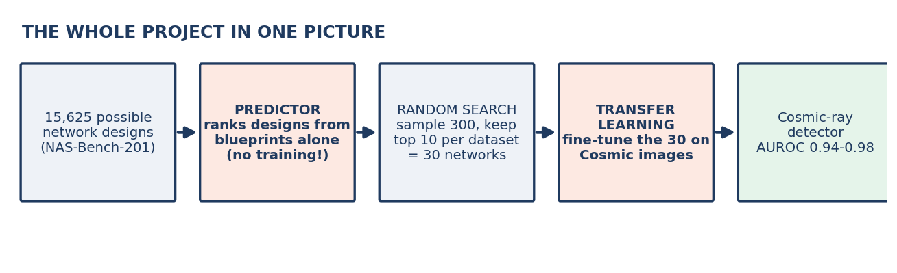

# Does Transfer Learning Work Across Domains?
### Adapting NAS-Bench-201 Architectures for Cosmic Ray Detection

**Course:** Recent Advances in Machine Learning (RAML), University of Siegen
**Supervisor:** Jun.-Prof. Dr. Jovita Lukasik
**Authors:** Muhammad Salim, Umair Talib

---

## Overview

Hubble Space Telescope images are contaminated by **cosmic rays** — high-energy
particles that leave bright streaks on the detector, which must be identified
and masked pixel-by-pixel before any scientific analysis. This project asks: can
we **cheaply predict good neural network architectures** from their performance
on standard image datasets (CIFAR-10, CIFAR-100, ImageNet16-120), **transfer**
their pre-trained weights, and fine-tune them for cosmic-ray detection — without
the enormous cost of training all 15,625 candidate architectures from scratch,
and without running NAS on the target task at all?

The pipeline has three stages:

```
   STAGE 1                    STAGE 2                       STAGE 3
┌─────────────┐         ┌──────────────────┐         ┌────────────────────┐
│  Surrogate  │         │   Guided random   │         │   Two-phase        │
│  predictor  │  ─────► │   search: sample  │  ─────► │   fine-tuning on   │
│  (SVR       │         │   300, rank, take │         │   Cosmic ray       │
│  ensemble)  │         │   top-10/dataset  │         │   detection        │
└─────────────┘         └──────────────────┘         └────────────────────┘
  15,625 archs             300 → 18 unique              30 fine-tuned nets
  ranked by predicted       architectures                AUROC evaluated
  source-domain accuracy    selected
```



**Result:** all 30 fine-tuned networks, using genuine NAS-Bench-201 pre-trained
weights, reach AUROC between **0.976 and 0.989** (mean 0.985) — exceeding every
from-scratch NAS-Bench-360 baseline reported for this task. Full details, tables,
and discussion are in [`report/RAML_Final_Report.pdf`](report/RAML_Final_Report.pdf).

| Source dataset | Mean AUROC | Max AUROC | Min AUROC |
|---|---|---|---|
| CIFAR-10 | 0.9843 | 0.9875 | 0.9760 |
| CIFAR-100 | 0.9857 | 0.9886 | 0.9841 |
| ImageNet16-120 | 0.9862 | 0.9886 | 0.9823 |
| **All combined (30 runs)** | **0.9854** | **0.9886** | **0.9760** |

The performance predictor (Stage 1) meets **all 9** of the professor's specified
Kendall-Tau targets, at training-set sizes p = 32 / 128 / 1024, across all three
source datasets:

| Dataset | p=32 (target) | p=128 (target) | p=1024 (target) |
|---|---|---|---|
| CIFAR-10 | 0.439 (0.39) | 0.597 (0.54) | 0.741 (0.74) |
| CIFAR-100 | 0.437 (0.39) | 0.601 (0.56) | 0.750 (0.74) |
| ImageNet16-120 | 0.433 (0.40) | 0.597 (0.56) | 0.743 (0.74) |

---

## Repository structure

```
.
├── README.md                              This file
├── requirements.txt                       Python dependencies
├── report/
│   ├── RAML_Final_Report.pdf              Full write-up: methodology, results, discussion
│   └── poster/                            LaTeX poster source (compile with lualatex; see report/poster/README.md)
├── src/
│   ├── task1_load_pretrained_weights/     Load provided DarcyFlow/NinaPro checkpoints
│   ├── task2_architecture_ranking/        Rank architectures per dataset
│   ├── task3_transfer_prototype/          First transfer-learning experiment + predictor + evolutionary search prototype
│   ├── task4_full_pipeline_v1/            First full-scale attempt (XGBoost predictor; superseded by task5)
│   └── task5_final_predictor_selection/   Final predictor (9/9 targets, SVR ensemble) + architecture selection
├── results_omni_cluster/                  Definitive fine-tuning (Umair's contribution — see its README)
├── docs/                                  In-depth technical explanations (predictor, random search, surrogate models)
└── assets/                                Diagrams used in this README
```

Each `src/taskN_*/` folder has its own README with what it does, key results,
and how to run it. Start with
[`src/task5_final_predictor_selection/README.md`](src/task5_final_predictor_selection/README.md)
if you only want the final, working pipeline.

---

## Setup

```bash
git clone <this-repo-url>
cd cosmic-ray-nas-transfer-learning

# 1. PyTorch matching your CUDA version (or CPU-only)
pip install torch==2.4.1 torchvision==0.19.1 --index-url https://download.pytorch.org/whl/cu124

# 2. Everything else
pip install -r requirements.txt
```

## Data

External datasets are **not vendored** in this repository (they're large and
publicly available) — download and place them as follows:

| Data | Used by | Source |
|---|---|---|
| NAS-Bench-201 checkpoints (DarcyFlow/NinaPro, 20 `.pth` files) | task1, task2 | Provided course materials |
| **Cosmic** ray dataset (deepCR ACS-WFC) | task3, task4, task5 | [deepCR project](https://github.com/profjsb/deepCR) — only the `f435w`/galaxy-field subset is actually used (~8 GB of the full ~58 GB) |
| **NATS-tss-v1_0-3ffb9-simple** (NAS-Bench-201 accuracy data, no weights) | task4, task5 | [NATS-Bench](https://github.com/D-X-Y/NATS-Bench) |
| **NASLib** ground truth (`nb201_all.pickle`) | task5 | [NASLib](https://github.com/automl/NASLib) |
| **NAS-Bench-201 full weight archive** (~360 GB, pre-trained weights) | `results_omni_cluster/` | [NATS-Bench full archive](https://github.com/D-X-Y/NATS-Bench) — only 18 of 15,625 architecture files are actually needed; see `src/task5_final_predictor_selection/omni_handoff/` for an extraction kit |

## Reproducing the pipeline

```bash
# Predictor + selection (task5 is the final, correct version — see its README)
python src/task5_final_predictor_selection/step1_predictor.py   # ~2-3 min
python src/task5_final_predictor_selection/step2_random_search.py  # ~1 min

# Fine-tuning: local baseline (random init) vs. the definitive cluster run
python src/task5_final_predictor_selection/step3_finetune.py    # ~4-5h GPU, random-init baseline
# The definitive run (genuine pre-trained weights, Omni HPC cluster) is in results_omni_cluster/
```

---

## Documentation

The [`docs/`](docs/) folder has in-depth, from-first-principles explanations of
the key methodology, useful for anyone reviewing or extending this work:

- [`VIVA_PREP.md`](docs/VIVA_PREP.md) — complete walkthrough of every task, every concept, with worked examples
- [`RANDOM_SEARCH_EXPLAINED.md`](docs/RANDOM_SEARCH_EXPLAINED.md) — the Stage 2 selection strategy in detail
- [`SURROGATE_MODEL_EXPLAINED.md`](docs/SURROGATE_MODEL_EXPLAINED.md) — surrogate models generally, and the Task 3 evolutionary-search experiment specifically (including an honest account of where the surrogate generalised well vs. poorly)

## Key methodology notes

- **Architecture encoding:** 210 dimensions — 30-dim per-edge one-hot (6 edges
  × 5 operations) + 180-dim path-based encoding of the 4 input-to-output DAG
  routes, which captures operation-interaction effects a flat encoding misses.
- **Predictor:** a rank-averaged ensemble of two RBF Support Vector Regressors
  (`C=20, γ=0.02` tuned for small training budgets; `C=10, γ='scale'` tuned for
  large budgets). An XGBoost baseline met only 5/9 Kendall-Tau targets, because
  tree ensembles overfit at small training sizes; the SVR ensemble meets 9/9.
- **Fine-tuning:** two-phase — Phase 1 (3 epochs, lr=1e-3) trains only the new
  segmentation head with the backbone frozen; Phase 2 (5 epochs, lr=1e-4)
  unfreezes the full network at a 10× lower learning rate, preventing
  catastrophic forgetting of the pre-trained representations.

## License

[MIT](LICENSE).

## Acknowledgements

NAS-Bench-201 [Dong & Yang, ICLR 2020], NATS-Bench [Dong et al., IEEE TPAMI
2021], NAS-Bench-360 [Tu et al., NeurIPS 2022], and the deepCR cosmic-ray
dataset [Zhang & Bloom, ApJ 2020]. Fine-tuning executed in part on the
University of Siegen Omni HPC cluster.
